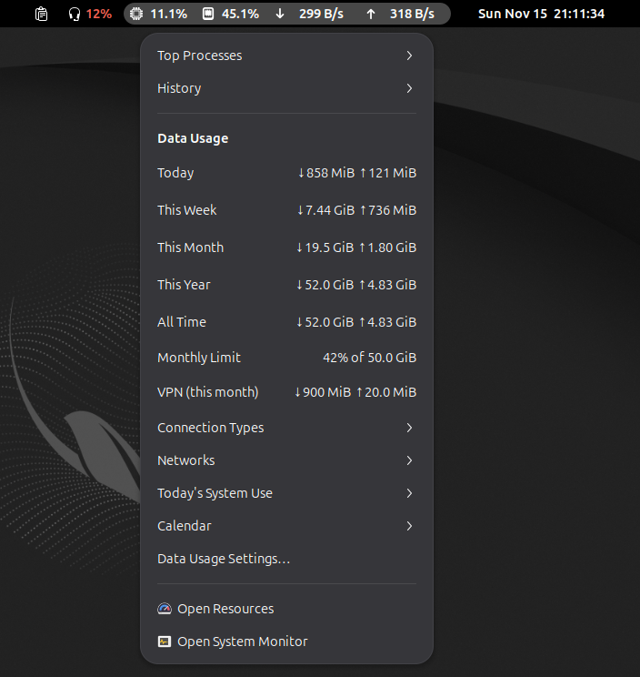
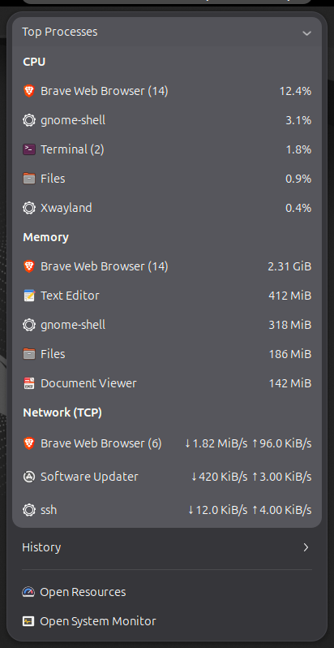
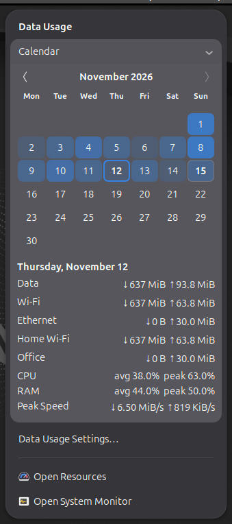
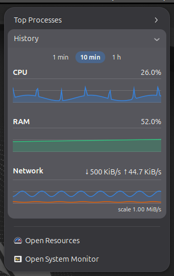
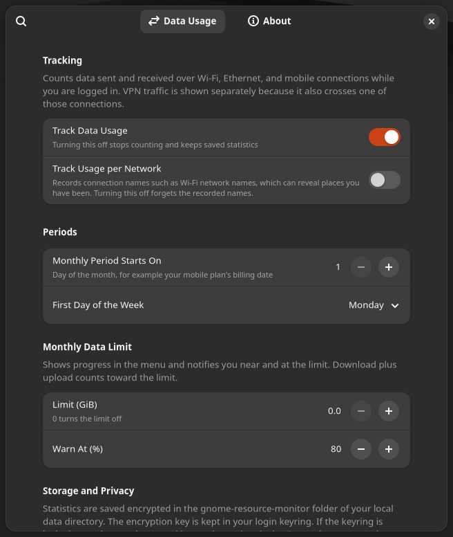

# Resource Monitor

Shows real-time CPU, RAM, and network usage in the GNOME top bar, and keeps encrypted data-usage statistics: how much you downloaded and uploaded today, this week, this month (or billing period), this year, and in total.

## Screenshots



| Top processes | Data usage calendar | History graphs |
| --- | --- | --- |
|  |  |  |



Screenshots: dark style, Dash-to-Panel top bar, synthetic data, from an isolated GNOME 51 test session.

## Metadata

```json
{
  "name": "Resource Monitor",
  "description": "Shows real-time CPU, RAM, and network usage in the GNOME top bar, with encrypted data-usage statistics (daily, weekly, monthly, yearly) and an optional monthly data limit.",
  "uuid": "resource-monitor@dileepa.dev",
  "version-name": "1.1.0",
  "shell-version": [
    "46",
    "50",
    "51"
  ],
  "version": 1,
  "url": "https://github.com/dileepadev/gnome-resource-monitor",
  "settings-schema": "org.gnome.shell.extensions.resource-monitor"
}
```

## Installation

### Manual Installation

1. **Clone the repository**, enter it, and compile the settings schema
   (requires `glib-compile-schemas`):

   ```bash
   git clone https://github.com/dileepadev/gnome-resource-monitor.git
   cd gnome-resource-monitor
   make schemas
   ```

2. **Link it into your local extensions directory**:

   ```bash
   mkdir -p ~/.local/share/gnome-shell/extensions
   ln -s "$PWD" ~/.local/share/gnome-shell/extensions/resource-monitor@dileepa.dev
   ```

3. **Log out and log back in** so GNOME Shell picks up the new extension.

4. **Enable the extension**:

   ```bash
   gnome-extensions enable resource-monitor@dileepa.dev
   ```

Because the extension directory is a symlink, `git pull` updates it in place.
Run `make schemas` again if the schema changed, then log out and back in to load
the new code. Open the settings with `gnome-extensions prefs resource-monitor@dileepa.dev`
or **Data Usage Settings…** in the menu.

## Panel layout

The indicator shows CPU and RAM usage as percentages and the download and upload
rates in binary units with at most three significant digits (for example
`86 B/s`, `1.23 KiB/s`, `12.3 MiB/s`, `123 GiB/s`). A dash (`—`) means a reading
is unavailable or still being measured.

The indicator keeps a constant width, so other top-bar icons do not shift as
the readings change. Each reading has a slot sized for its widest possible
value, measured with your font, text scaling, and display scaling; values are
right-aligned and never shortened with an ellipsis. The edge spacing matches
AppIndicator icons in Ubuntu's default compact mode.

## Top processes and history

- **Top Processes** lists the five processes using the most CPU and the most
  memory, refreshed every 2 seconds while the list is open. Processes with the
  same name are grouped with a count, for example `code (22)`, and apps with an
  open window show their name and icon. CPU is a share of the whole machine,
  like the panel reading; memory is resident memory (RSS). The list only reads
  `/proc` while it is open. Processes without an app (for example
  `gnome-shell` or kernel threads) show a gear icon.
- **Network (TCP)**, in the same list, shows which apps are using the network
  right now (download and upload per second), from the byte counters of your
  own processes' TCP connections (`ss`, part of iproute2). It is a live view
  while the list is open, not a saved total. UDP and QUIC traffic (used by
  some browsers and video calls) and other users' processes are not visible
  this way; exact per-app accounting would need privileged tools.
- **History** shows CPU, RAM, and network (download and upload) graphs for the
  last minute, 10 minutes, or hour. Readings are kept in memory only, for up to
  one hour, and are not saved.
- While Top Processes, History, or the calendar is open, the other menu
  sections are hidden so the open one fits on screen.

## About

**Data Usage Settings…** → **About** shows the version, description, links to
the project, issue tracker, and license, and a privacy summary.

## Data usage

The menu shows how much was downloaded (↓) and uploaded (↑):

- **Today**, **This Week**, **This Month** (or **Since** your billing date),
  **This Year**, and **All Time**.
- **Monthly Limit** progress, when a limit is set. You are notified once when
  usage passes the warning threshold (80% by default) and once when it reaches
  the limit, per billing period.
- **VPN** traffic, shown separately.
- **Connection Types**: Wi-Fi, Ethernet, and mobile and tethering.
- **Networks**: usage per connection name (for example the Wi-Fi network),
  when enabled in the settings. Off by default, because network names can
  reveal places you have been; turning it off also forgets the names already
  recorded.
- **Today's System Use**: average and peak CPU and RAM, and peak download and
  upload speed.
- **Calendar**: a month view of your daily history. Days are shaded by how much
  data was used compared with the busiest day of that month; today is outlined.
  Select a day to see its download and upload, VPN traffic, Wi-Fi/Ethernet/mobile
  split, networks, average and peak CPU and RAM, and peak speeds. Use ‹ and › to
  move between months that have data. While the calendar is open, the other
  rows are hidden so the calendar and the day's details fit on screen. Days
  older than the daily-history setting are no longer available.

What is counted:

- Traffic over physical connections (Wi-Fi, Ethernet, mobile broadband, and USB
  tethering) while you are logged in and the extension is running. Traffic
  before login or while the extension is off is not seen.
- VPN interfaces (for example `tun`, `wg`, `tailscale`) are tracked separately,
  because their traffic also crosses a physical connection and would otherwise
  be counted twice. Container, bridge, and other virtual interfaces (Docker,
  libvirt, bonds) are ignored for the same reason. `ppp` interfaces count as
  mobile.
- Counts come from the kernel's interface byte counters, so they include all
  applications. Your provider may count slightly differently.

Settings (**Data Usage Settings…** in the menu): turn tracking on or off, track
usage per network, the day the monthly period starts (1–28), the first day of the
week, a monthly limit in GiB and its warning threshold, how many days of daily
history to keep (default 730; monthly and all-time totals are always kept), and
**Reset Statistics**.

### Storage and privacy

- Statistics are saved every 5 minutes and when the extension is disabled (for
  example at logout or screen lock) in
  `~/.local/share/gnome-resource-monitor/usage.sealed`, readable only by you.
- The file is **encrypted** with ChaCha20 and authenticated with HMAC-SHA256,
  using a fresh random nonce for every save. The random key is stored in your
  login keyring as "Resource Monitor data-usage encryption key".
- Resource Monitor never asks you to unlock the keyring itself. If it is locked
  (for example after automatic login), counting continues in memory and the
  saved statistics are loaded and updated once it is unlocked. Nothing is ever written
  unencrypted, and existing statistics are never overwritten before they have
  been read.
- If the file cannot be read (for example it was modified or its key was
  deleted), it is left untouched and new usage is not saved until you choose
  **Reset Statistics**.
- **Reset Statistics** deletes the file and its key. Turning tracking off stops
  counting and keeps the saved statistics.
- Encryption protects the saved file (for example in backups or a copied home
  directory). It does not hide statistics from programs running in your
  unlocked session.

## Opening a system monitor

Click the panel indicator to open the menu. It shows **Open Resources**, **Open
System Monitor**, or both, depending on which apps are installed. App names follow
your desktop language. If neither is available, the menu shows a disabled message.

The app list refreshes each time the menu opens. Resources' current and older
desktop entries are recognized, including Flatpak installations registered with
your desktop. If both Resources entries exist, the current one is preferred.

## Credits

- Icons: <https://gitlab.gnome.org/World/design/icon-library>

>[!NOTE]
> Read [`docs/DEVELOPMENT.md`](./docs/DEVELOPMENT.md) for development guidelines.
